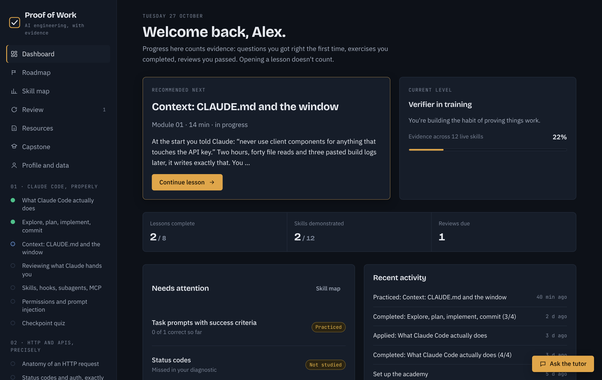
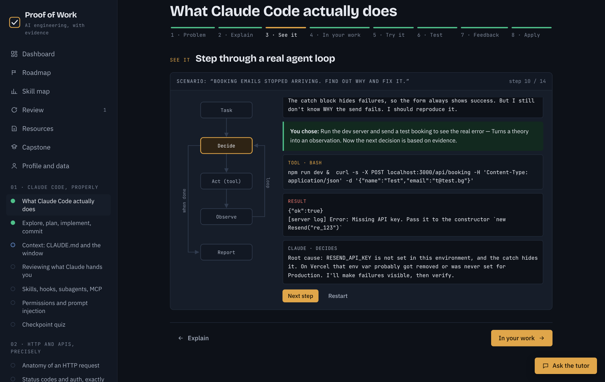
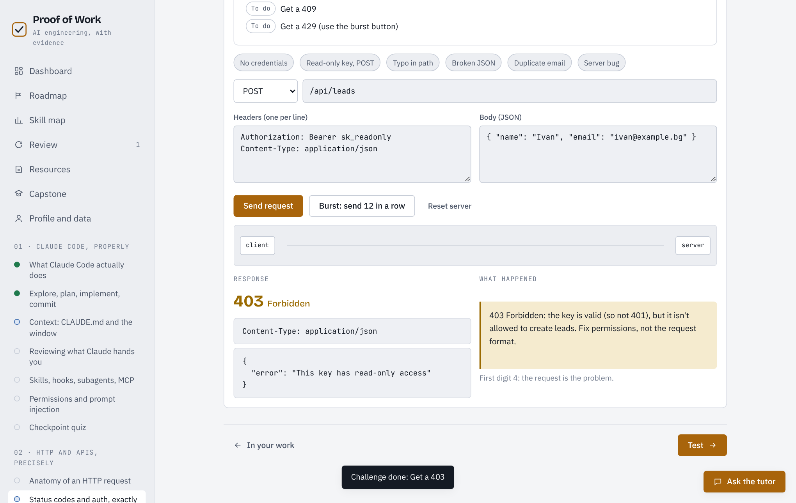
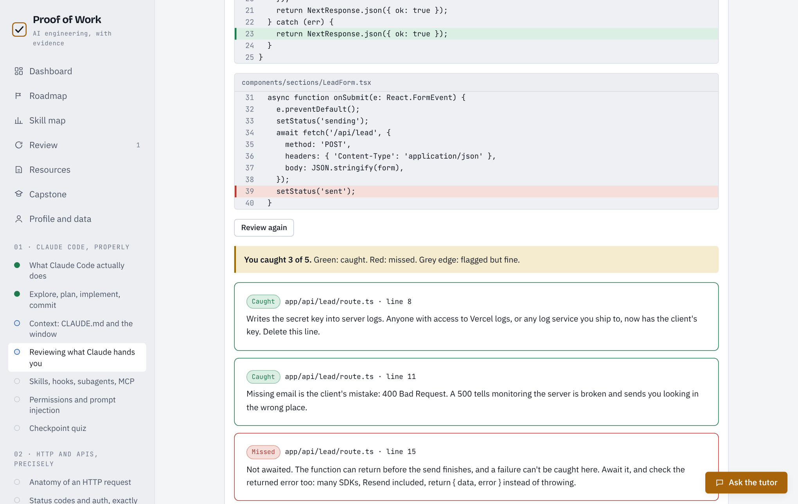

# Proof of Work

**An AI engineering academy where you only "know" something once you've proven it.**

Proof of Work teaches the skills behind AI-assisted software: how Claude Code actually works, how to steer and verify it, and the HTTP layer underneath every integration. It's for builders who already ship with AI and want to understand what they're shipping. Progress counts evidence only: questions answered correctly on the first try, completed hands-on labs, and passed spaced reviews. Opening a lesson counts for nothing.



## Why it exists

AI coding tools make it easy to ship code you haven't read. The usual failure isn't the model writing bad code. It's a human accepting "Fixed!" without evidence. Every lesson here is built around closing that gap: reproduce the problem, verify the fix, read the diff.

## What's inside

**Module 01: Claude Code, properly** (6 lessons + checkpoint quiz)
The agentic loop · explore → plan → implement → commit · context windows and CLAUDE.md · reviewing generated code · skills, hooks, subagents and MCP · permissions and prompt injection

**Module 02: HTTP and APIs, precisely** (2 lessons)
Request anatomy · status codes and authentication (401 vs 403, and why it matters)

**Modules 03–11** are mapped on the roadmap and build toward a capstone: an AI lead-handling agent that goes from a web form to an API, then Claude qualification, the CRM, and a reply drafted for human approval.

Every lesson follows the same eight steps: **Problem → Explain → See it → In your work → Try it → Test → Feedback → Apply.**

## Interactive labs

Each lab teaches one specific skill. None are there for decoration.

| Lab | What you practice |
|---|---|
| Agent loop stepper | Step through a real debugging session and make the agent's decisions, including the wrong branches |
| Workflow builder | Sequence a feature build correctly and spot the traps (secrets in chat, scope creep, testing in production) |
| Prompt lab | Rewrite a weak task prompt, graded against a 5-point rubric by keyword check or by Claude |
| Context simulator | Watch a session fill the context window; use `/compact` and `/clear` |
| Code review | Find five production bugs in a generated Next.js diff |
| Permission simulator | See how modes and allow/deny rules decide what Claude may do |
| HTTP lab | Send requests to a simulated API and trigger every common status code on purpose |

<table>
<tr>
<td></td>
<td></td>
</tr>
<tr>
<td></td>
<td>

### How progress works

Each skill climbs four evidence levels:

1. **Introduced**: you studied it
2. **Practiced**: you completed its lab
3. **Demonstrated**: 70%+ correct across first attempts and reviews
4. **Ready to apply**: demonstrated, used in real work, and a spaced review passed

A wrong answer returns for review the same day. A right answer returns after 3, 7, 16, then 35 days.

</td>
</tr>
</table>

## Getting started

It's a single self-contained page, with no framework and no runtime dependencies.

```bash
git clone https://github.com/dani-aisystems/proof-of-work
cd proof-of-work
open dist/index.html     # macOS; or just double-click it
```

On first launch it asks for a name, three questions about how you work, and an eight-question diagnostic. That takes about three minutes. Diagnostic misses are flagged across the dashboard and skill map. To rebuild after editing the source, run `npm run build` (Node 18+).

**Deploy:** `dist/` is a static site. Point Vercel, Netlify or GitHub Pages at it as-is.

### Two ways to run it

| | Standalone (`dist/index.html`) | As a Claude artifact (`dist/artifact.html`) |
|---|---|---|
| Lessons, labs, quizzes, review | ✓ | ✓ |
| Progress saved | In this browser (localStorage) | In a private per-user store on your Claude account |
| AI tutor and AI grading | Hidden. Written answers fall back to model answers and self-assessment | ✓, using the viewer's own Claude account |
| Export / import progress | ✓ | ✓ |

### Pre-filling your own profile

To skip setup in your own build, copy `src/profile.local.example.js` to `src/profile.local.js` (gitignored) and fill it in. `npm run build` then also writes `private/artifact.html` (gitignored) with your profile baked in. Committed files never contain it.

## Project structure

```
src/
  content.js                 curriculum: lessons, questions, setup and diagnostic, lab data, sources
  app.js                     engine: routing, mastery model, storage, labs, tutor
  styles.css                 design tokens (light + dark) and components
  profile.local.example.js   template for an optional private profile
scripts/
  build.mjs                  assembles src/ into dist/
dist/                        built pages, committed so the app runs without a build step
docs/                        screenshots
```

**Adding a lesson:** add an entry to `LESSONS` in `src/content.js`, list its id in a module's `lessons` array in `MODULES`, then run `npm run build`. The lesson automatically gets the stepper, the test flow, spaced review and the skill map.

## Checks

```bash
npm test       # curriculum links, skills, modules, lessons, resources and quizzes
npm run check  # integrity test + rebuild + confirms committed dist/ is current
```

The integrity test catches broken content references and stale built files. It does not assess teaching quality, factual accuracy, browser behaviour or accessibility; those still need review in the rendered product.

## Design decisions

- **No framework.** It's one HTML file with vanilla JS, so it can be published as a Claude artifact, opened from disk, or deployed anywhere with no build tooling.
- **Evidence over activity.** Mastery is computed from first-attempt answers and reviews, never from page views.
- **Accurate over impressive.** Claude Code facts were checked against the [official docs](https://code.claude.com/docs/en/best-practices) on 25 Oct 2026. HTTP follows [MDN](https://developer.mozilla.org/en-US/docs/Web/HTTP/Guides/Overview). Simulations are labelled as simulations. Video links were checked against YouTube's own metadata, but their contents weren't reviewed in full.
- **Private by default.** The learner profile lives with each user's saved progress, not in the code.

## License

[MIT](LICENSE) © 2026 Daniel Yanchev
